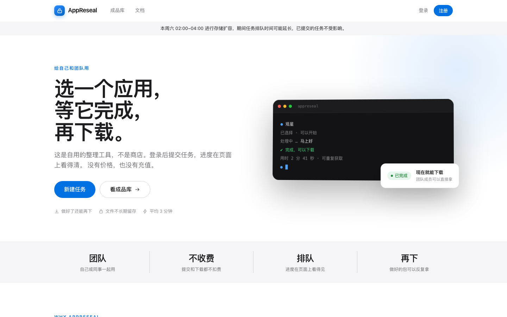
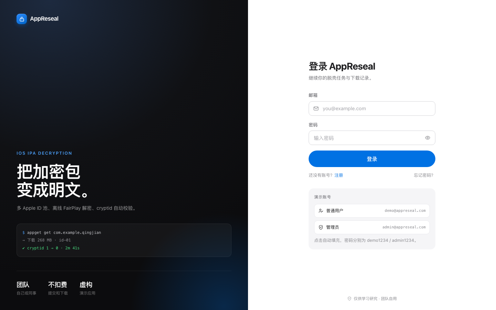
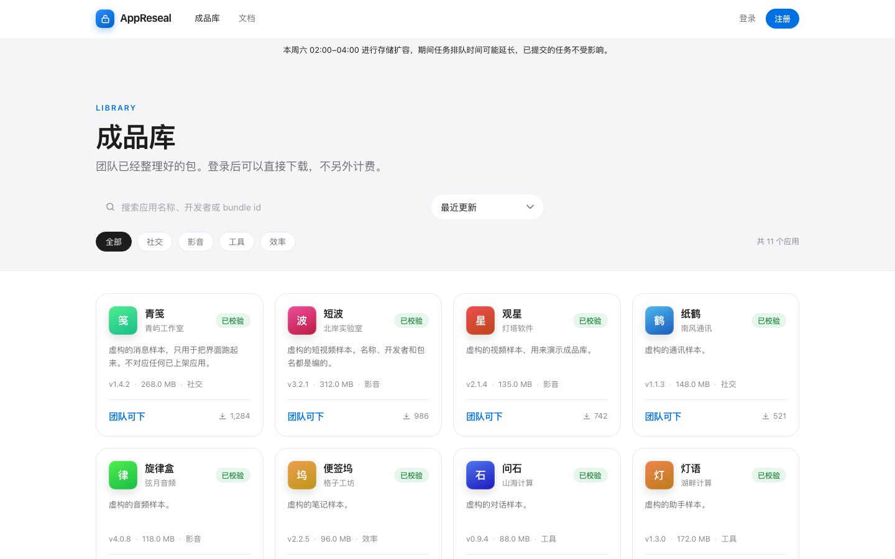
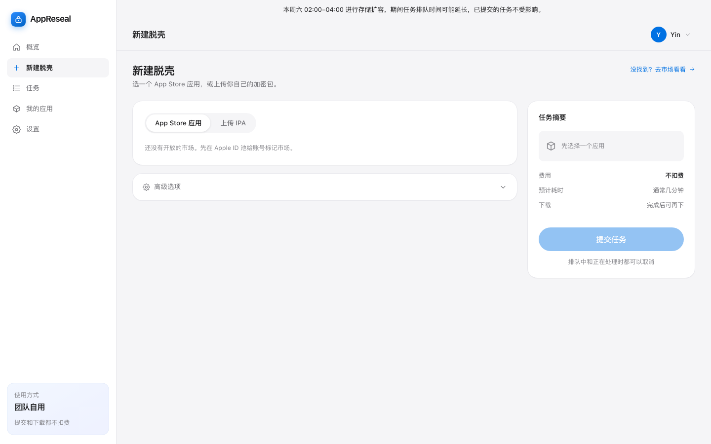
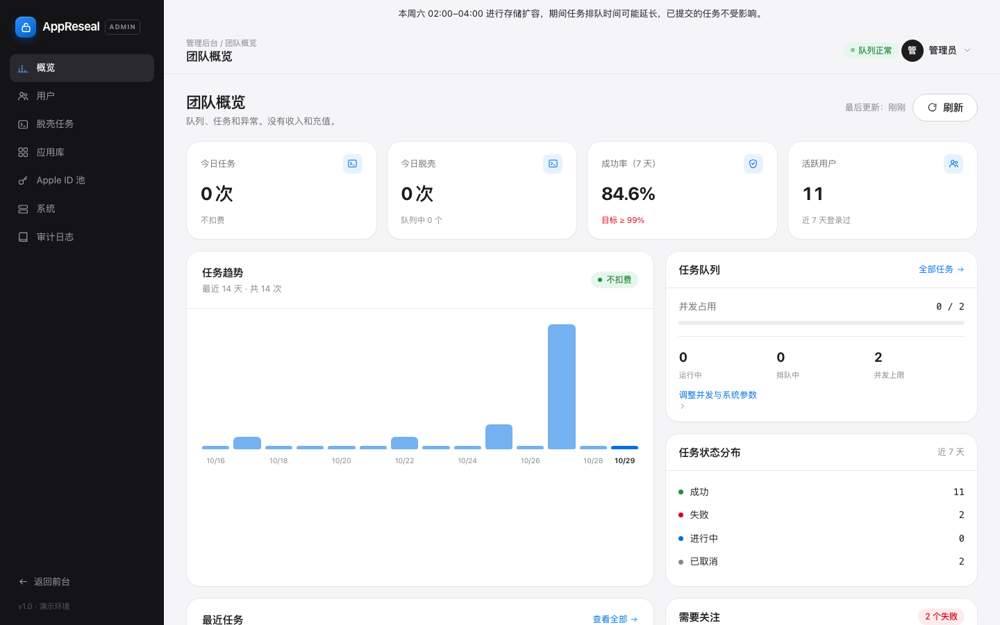
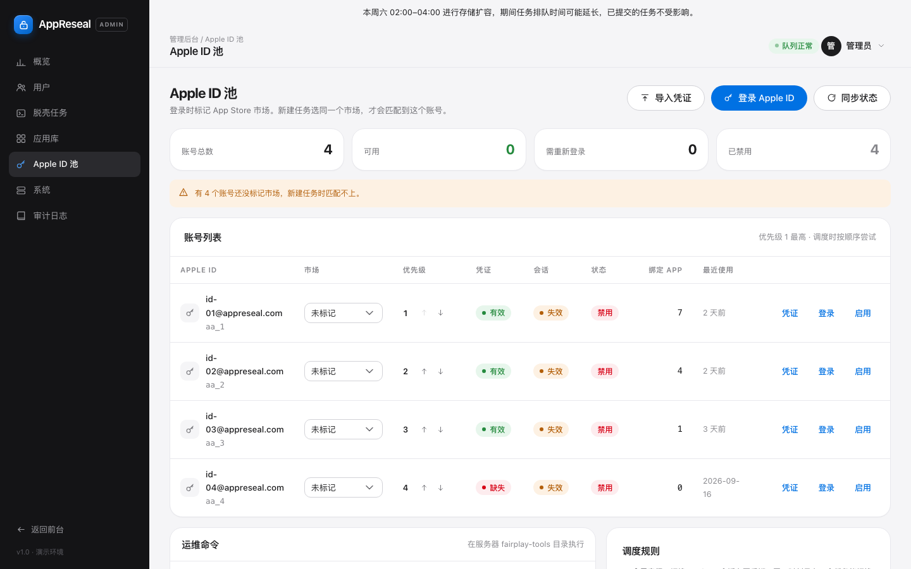

# AppReseal

中文 | [English](README.en.md) | [日本語](README.ja.md)

给自己或小团队用的整理工具。选一个 App Store 应用，或上传自己的加密 IPA，等任务完成后再下载。

不需要使用者准备越狱设备。下载、解密和校验都在服务端完成。没有钱包、价格和充值。



**免责声明：本项目仅供学习研究。** 请只处理你有权分析的安装包。不要用它传播盗版、绕过付费，或从事违法用途。

## 它能做什么

- 从 App Store 选择应用并提交脱壳任务，也可以上传自己的加密 IPA。
- 上传大文件时显示进度，中断后可以接着传，不必整包重来。
- 完成后用短时链接下载，支持断点续传。
- 排队中和正在处理的任务都可以取消。取消只是停掉这次处理，不涉及退款。
- 管理后台可以维护 Apple ID 池、团队账号和存储清理。
- 普通用户看不到服务器路径、账号和脚本名。这些细节只给管理员。

演示数据里的应用和账号都是假的，用来把界面跑起来。真实脱壳还要你自己准备 Apple ID 和 16 字节的 `credential.bin`。

## 界面

登录页带两个演示账号，点一下就能填上。



成品库里的应用、开发者和包名都是虚构的，只用来把界面跑起来。登录后可以直接下载，不另外计费。



新建任务时，市场列表只会出现 Apple ID 池里已经开放的市场。还没标记市场时，页面会提示先去后台处理。



管理后台能看到队列和任务状态，没有收入和充值。



Apple ID 在后台登录。密码只用于这一次登录，不写入数据库。`credential.bin` 需要另外导入。



## 安装

需要 Docker Desktop，以及能访问外网来拉取镜像和依赖。第一次构建会编译解密引擎，大概要几分钟。

```bash
git clone <你的仓库地址> appreseal
cd appreseal
docker compose up -d --build
```

打开 [http://127.0.0.1:8088](http://127.0.0.1:8088)。

| 角色 | 邮箱 | 密码 |
| --- | --- | --- |
| 普通用户 | `demo@appreseal.com` | `demo1234` |
| 管理员 | `admin@appreseal.com` | `admin1234` |

停止服务：

```bash
docker compose down
```

数据在 Docker 卷里。`docker compose down -v` 会把数据库和上传文件一起删掉。

### 交给别人用之前

`docker-compose.yml` 里的数据库密码和 `APPRESEAL_JWT_SECRET` 是本机演示值。放到公网前必须改掉，并加上 HTTPS。

## 使用

### 1. 准备 Apple ID

1. 用管理员账号登录，打开「Apple ID 池」。
2. 点「登录 Apple ID」，选择市场，输入密码。如果弹出双重验证，再填 6 位验证码。
3. 按下面的方式准备 `credential.bin`，再点「导入凭证」上传。文件必须正好 16 字节。
4. 给账号标记市场，并保持启用。

#### `credential.bin` 怎么来

获取方式请参考上游项目 [fairplay-decrypt](https://github.com/EthanArbuckle/fairplay-decrypt)。本仓库附带的 [`backend/docker/fairplay/fairplay-decrypt`](backend/docker/fairplay/fairplay-decrypt) 只负责解密，不要在本站里找生成按钮。

`decrypt.py` 通过 `--credential` 读取已经保存好的凭证，默认就是该目录下的 `credential.bin`。脚本会检查长度，不是正好 16 字节就拒绝运行。同目录没有单独的导出或生成脚本；登录 Apple ID 也不会写出这个文件。`fairplay-tools/appget.sh` 的 `account credential <邮箱> <路径>` 只是把现成文件绑到账号上。

准备好 16 字节文件后，在管理后台「Apple ID 池」导入。服务按邮箱存到数据卷 `creds/<邮箱>/credential.bin`，密码不会一起保存。

新建任务时，成员只能选已经有可用账号的市场。上传的 IPA 也必须能被池里某个 `credential.bin` 解开，否则任务会失败。失败不扣费。

这些文件只放在数据卷 `/app/data/ipatool`，不要提交到 Git。

### 2. 提交脱壳

普通用户登录后，打开「新建脱壳」。

- **App Store 应用：** 选市场，搜索应用，提交任务。
- **上传 IPA：** 选择或拖入 `.ipa`。页面会显示上传进度。网络中断后，用同一个文件再点一次「提交任务」，会从上次的位置继续。

任务完成后，在详情页下载。下载链接 15 分钟内有效，支持断点续传。

处理中如果想停掉，点「取消任务」。服务会停止这次拉起的进程。

### 3. 成品库

首页和「成品库」里的包是已经整理好的。登录后可以直接下载，没有购买和免费期。

### 4. 存储

管理员在「系统设置 → 存储与清理」里能看到磁盘占用，并调整保留期。默认产物保留 30 天，失败任务的上传包保留 14 天，任务日志保留 90 天。到期后文件会删除，任务记录还在，详情页会显示产物已过期。

## 本地开发

不想用 Docker 时，可以分别启动前后端。后端默认用 H2 文件库，执行器是模拟的，不会真的下载或解密。

```bash
# 后端，需要 JDK 21
cd backend
./mvnw spring-boot:run

# 前端，需要 Node.js 20+
cd frontend
npm install
npm run dev
```

前端开发地址是 [http://127.0.0.1:5173](http://127.0.0.1:5173)。要连真接口时：

```bash
VITE_API_MODE=real VITE_API_BASE=http://127.0.0.1:8080/api/v1 npm run dev
```

## 常用配置

这些变量写在 `docker-compose.yml` 的 `backend.environment` 里。

| 变量 | 作用 |
| --- | --- |
| `APPRESEAL_JWT_SECRET` | 登录令牌密钥，至少 32 字节。公网必须更换 |
| `APPRESEAL_SEED` | 空库是否写入演示用户和应用 |
| `APPRESEAL_EXECUTOR_MODE` | `shell` 调用镜像内的真实脚本；`mock` 只模拟进度 |
| `APPRESEAL_DOWNLOAD_LINK_TTL_MINUTES` | 下载链接有效期，默认 15 分钟 |
| `APPRESEAL_MAIL_ENABLED` | 打开后才能发找回密码邮件 |
| `APPRESEAL_MAIL_HOST` / `USERNAME` / `PASSWORD` / `FROM` | SMTP。587 用 STARTTLS，465 再把 `APPRESEAL_MAIL_SSL` 设为 `true` |

找回密码没配 SMTP 时，页面会明确说暂不可用，不会假装已经发信。

## 不要提交的文件

仓库已经忽略这些路径。它们属于运行数据，不是源码：

- `*.ipa`
- `credential.bin`
- `*.session`、cookie、`.ipatool-passphrase`
- `backend/data/` 和 Docker 数据卷

## 目录

```text
backend/     Spring Boot API，以及镜像内的脱壳脚本
frontend/    Vue 3 界面
docs/        界面截图
docker-compose.yml
```

更细的界面说明在 [`docs/UI-DESIGN.md`](docs/UI-DESIGN.md)。

## 免责声明

本项目仅供学习研究。

请只处理你有权分析的安装包。不要用于传播盗版、绕过付费或其他违法用途。使用者须自行遵守所在地法律，并自行承担使用后果。软件按「原样」提供，作者与贡献者不承担由此产生的损失或责任。

这段说明是使用提醒，不是许可证条款。代码本身仍按下面的 MIT 许可证授权。

## 许可证

本项目使用 [MIT License](LICENSE)。你可以自由使用、修改和再发布，保留版权声明即可。软件按「原样」提供，作者不承担使用造成的损失。
